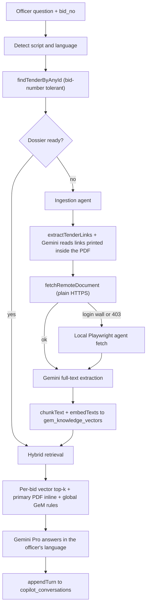

# Enterprise GeM Co-Pilot and Document Studio

## Recommended stack, and where I disagree with the brief

You asked me to evaluate Puppeteer/Playwright, `pdf-parse` and LangChain. My recommendation is to use none of the three as new dependencies, and here is the reasoning rather than just the verdict.

**`pdf-parse`: do not use.** GeM bid documents and buyer ATC attachments are frequently image-based scans, and `pdf-parse` returns empty or garbage for those. It also flattens tables, which is exactly where BOQ lines and eligibility thresholds live. Every PDF in this repo is already read by handing bytes to Gemini as `inlineData` with `mimeType: 'application/pdf'` — see [app/api/ai/analyze/route.js](app/api/ai/analyze/route.js) and [app/api/ai/tender-deep-dive/route.js](app/api/ai/tender-deep-dive/route.js). Gemini OCRs scans, preserves table semantics, and reads Telugu text in the document. It is both more accurate and already proven here.

**LangChain: do not use.** Everything it would supply already exists in ~170 lines of [lib/gem-embeddings.js](lib/gem-embeddings.js) — paragraph-aware chunking, batched `text-embedding-004` with correct asymmetric `taskType`, Atlas Vector Search bootstrapping, and a cosine fallback — and it is covered by [scripts/verify-gem-rag.mjs](scripts/verify-gem-rag.mjs). Adding LangChain buys an abstraction we would have to fight to get the `$vectorSearch` filter this design needs, plus a large dependency and version churn.

**Playwright: reuse, do not add.** It is already a devDependency driving [scripts/gem-local-agent.js](scripts/gem-local-agent.js) against an authenticated GeM session. It becomes the fallback fetcher only when a plain HTTPS request hits a login wall.

Net new dependencies: zero.

## Feature 1: Agentic RAG Co-Pilot

### Flow



### Link discovery is two-stage

Regex over tender fields is not enough — the real SOW and buyer ATC links are printed *inside* the bid PDF body, not in the tender record. So:

1. [lib/tender-links.js](lib/tender-links.js) `extractTenderLinks()` for record-level URLs. It already classifies SOW/ATC/BOQ/CORRIGENDUM and carries an SSRF guard.
2. A Gemini pass over the primary bid PDF that returns any additional document URLs and their labels as JSON. This is the agentic step the brief asks for, and it is the only way to reach buyer-added ATC attachments.

### Fetching, with a fallback that matches reality

Promote `fetchRemoteDocument()` out of [app/api/ai/tender-deep-dive/route.js](app/api/ai/tender-deep-dive/route.js) into `lib/remote-document.js`. It already handles redirects, a 20s timeout, a 12MB cap, and detects the login wall case where a portal serves HTML with a 200 status.

When it reports a login wall, retry through a new `POST /api/fetch-document` endpoint on [scripts/gem-agent-server.js](scripts/gem-agent-server.js), which downloads inside the already-authenticated headful browser and returns base64. On Vercel that fallback is unreachable, so the document is marked `needs_local_agent` and the UI tells the officer to run the ingest from the office machine rather than failing silently.

Fetched PDFs are cached to R2 under `bid_dossier/<bid_no>/` so a bid is downloaded once, ever.

### Ingestion must be incremental, not one long request

Reading three to five PDFs through Gemini will exceed Vercel's 60s function limit. `POST /api/tenders/dossier` therefore ingests **one pending document per call** and returns `{ done, remaining, current }`; the client loops with a progress bar. No queue infrastructure, no timeout risk.

### Hybrid retrieval

Chunks go into the existing `gem_knowledge_vectors` with `document_id = bid::<bid_no>::<type>` plus a new `bid_no` filter field. Query time combines three sources:

- per-bid vector top-k, filtered to that bid
- the primary bid PDF inline in context (what [app/api/ai/chat/route.js](app/api/ai/chat/route.js) `loadTenderContext` already does)
- the global GeM rules KB via the existing `retrieveGemKnowledge`

Note: adding a filter field means the Atlas index definition changes, which requires `updateSearchIndex`, not `createSearchIndex`. `ensureVectorIndex` in [lib/gem-embeddings.js](lib/gem-embeddings.js) needs that branch. The existing in-memory cosine fallback covers the rebuild window.

### Telugu prompt engineering

New `lib/language.js`.

**Detection.** Script-based, not language-guessing: `/[\u0C00-\u0C7F]/` identifies Telugu script reliably. Romanised Telugu ("Tenglish") cannot be detected reliably, so the UI carries an explicit `English / తెలుగు / Auto` selector defaulting to Auto, and Auto uses script detection. The selector is the escape hatch, not the primary mechanism.

**Retrieve in English, answer in Telugu.** The corpus is English. Translating source documents would compound translation error into retrieval. So for a Telugu question we embed both the original and a cheap Flash English translation of the *query only*, merge the two result sets, and keep every retrieved chunk in its original English. Translation happens once, at answer time.

**Never-translate list, stated in the prompt as a hard rule.** Bid numbers, clause and ATC references, statutory names (GFR 2017, GeM GTC), document titles, monetary figures, percentages and dates stay verbatim. Telugu prose carries the English term in parentheses on first use.

**A fixed glossary block in the system prompt.** Without it the model renders "undertaking" three different ways across three answers and officers lose confidence. Pinning EMD, undertaking, bid, tender, eligibility, turnover and similar to one agreed Telugu form each makes the output consistent.

**The refusal must also be in Telugu.** The existing rule "if the context does not contain the answer, say so plainly" is worthless if it silently reverts to English.

## Feature 2: Document Studio (chat to canvas)

### Server-authoritative state machine

`gathering` → `outline_pending` → `confirmed` → `rendered`, persisted in a new `doc_sessions` collection so a refresh does not lose the interview.

Each turn the model returns structured JSON, not prose:

```json
{
  "phase": "gathering",
  "reply": "Which letterhead should this go on?",
  "slots": { "doc_type": "bid_undertaking", "tender_id": "GEM/2026/B/7938430" },
  "missing": ["client_email", "letterhead_id"],
  "outline": null
}
```

The critical property: **the model proposes, the server decides.** `POST /api/documents/session` merges the slots, validates each against real data (does the client exist, does the tender resolve, does the letterhead exist), and refuses to advance to `outline_pending` while anything required is missing. An LLM cannot talk itself into generating a document for a hallucinated client.

### The confirmation gate

When phase reaches `outline_pending` the canvas renders the outline — sections, the facts it will use, and every placeholder it cannot fill — with an explicit Generate button. Generation only fires on `action: 'confirm'` carrying the matching `outline_hash`. A typed "yes" in chat is accepted too, but it is routed through that same confirm action, so there is exactly one path to generation and the outline cannot drift between approval and render.

Rendering reuses [app/api/tenders/generate-docs/route.js](app/api/tenders/generate-docs/route.js) unchanged.

### React component architecture

```
components/doc-studio/
  DocStudio.jsx          shell, split pane, owns session id
  DocStudioChat.jsx      left pane: transcript + composer
    ChatMessage.jsx      user / assistant / system bubbles
    SlotChips.jsx        live strip: Client OK, Tender OK, Letterhead pending
    QuickReplies.jsx     model-suggested answers as buttons (client and letterhead pickers)
  DocStudioCanvas.jsx    right pane, switches on phase
    EmptyCanvas.jsx        gathering: checklist of what is still needed
    OutlinePreview.jsx     outline_pending: sections, facts, placeholders, Confirm CTA
    DocumentPreview.jsx    rendered: letterhead-accurate preview + Download
  useDocSession.js       hook: session POST/GET, optimistic messages, phase
```

Split pane rather than pure chat because the confirmation gate only works if the outline stays visible while the user types their objection to it. Chat left at roughly 40%, canvas right at 60%, stacking into tabs below `lg`. Styling follows the existing language (navy `#0A2647`, emerald accents, `premium-table`, Radix/shadcn) so it reads as native rather than bolted on.

This replaces the [components/DocumentLetterheadGenerator.jsx](components/DocumentLetterheadGenerator.jsx) card at both mount points, in [app/admin/page.js](app/admin/page.js) and [app/employee/page.js](app/employee/page.js). The tender requirement checklist added earlier today moves into `EmptyCanvas` so the AI opens the conversation already knowing what the bid demands.

## Data model additions

- `tenders.bid_dossier` — manifest of documents, status, chunk count, per-document failures
- `gem_knowledge_vectors` — new `bid_no` filter field, index definition updated
- `doc_sessions` — Document Studio sessions
- R2 prefix `bid_dossier/`

## Main risks

- Atlas index definition change needs `updateSearchIndex`; in-memory fallback covers the rebuild window.
- Ingestion latency is real — one document per request with a client-side progress loop is what keeps it inside Vercel limits.
- Gemini Pro has no free tier, so a key without billing will 429 and degrade to Flash. The fallback in [lib/gemini.js](lib/gemini.js) handles it, but Telugu and clause-level accuracy will be visibly worse on Flash.

Awaiting your "approved" before I write step 1.